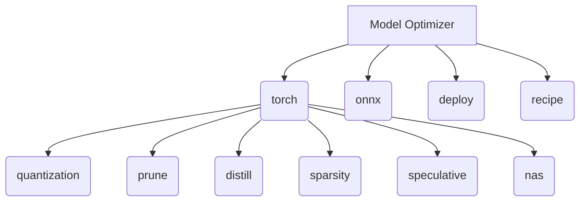

# NVIDIA Model Optimizer

Model Optimizer is a library comprising state-of-the-art model optimization techniques including quantization, pruning, NAS, distillation, speculative decoding, and sparsity to accelerate models for deployment.

 


## Features

- **Post Training Quantization (PTQ)**: Compress model size by 2x-4x, speeding up inference while preserving model quality. See examples in [`examples/hf_ptq`](./examples/hf_ptq/) and [`examples/megatron_bridge`](./examples/megatron_bridge/README.md#post-training-quantization).
- **Quantization Aware Training / Distillation**: Refine accuracy of quantized models even further with a few training steps. See examples in [`examples/llm_qat`](./examples/llm_qat/).
- **Pruning**: Reduce your model parameters or memory footprint and accelerate inference by removing unnecessary weights. See examples in [`examples/pruning`](./examples/pruning/).
- **Distillation**: Reduce deployment model size by teaching small models to behave like larger models. See examples in [`examples/llm_distill`](./examples/llm_distill/).
- **Speculative Decoding**: Train draft modules to predict extra tokens during inference. See examples in [`examples/speculative_decoding`](./examples/speculative_decoding/).
- **Sparsity**: Efficiently compress your model by storing only its non-zero parameter values and their locations. See examples in [`examples/llm_sparsity`](./examples/llm_sparsity/).

## Architecture



The Model Optimizer library is structured into multiple core modules handling different frameworks and formats, with PyTorch and ONNX being the primary engines. Within the PyTorch module (`torch`), it provides implementations for various optimization techniques including quantization, pruning, knowledge distillation, sparsity, speculative decoding, and neural architecture search (NAS).

## Quick start

To install the stable release packages from PyPI:
```bash
pip install -U nvidia-modelopt[all]
```

To install from source in editable mode with all development dependencies:
```bash
git clone git@github.com:walladanger/Model-Optimizer.git
cd Model-Optimizer
pip install -e .[dev]
```

## Configuration

| Environment Variable | Purpose | Default |
|----------------------|---------|---------|
| `HF_HUB_OFFLINE` | Disables Hugging Face Hub downloads and uses offline caching | `""` |
| `WORLD_SIZE` | Defines the total number of processes participating in the job (for distributed operations) | `1` |
| `LOCAL_RANK` | Defines the local process rank on the current node (for distributed operations) | `0` |
| `VLM_MAX_PROMPT_TOKENS` | Defines the maximum number of prompt tokens for VLM transformers datasets | None |

## Screenshots

<!-- SCREENSHOT PLACEHOLDER: hero image of <what to capture> -->
_Screenshot coming soon._

## Roadmap

See issues.

## License & credits

Licensed under the [Apache License 2.0](LICENSE).
